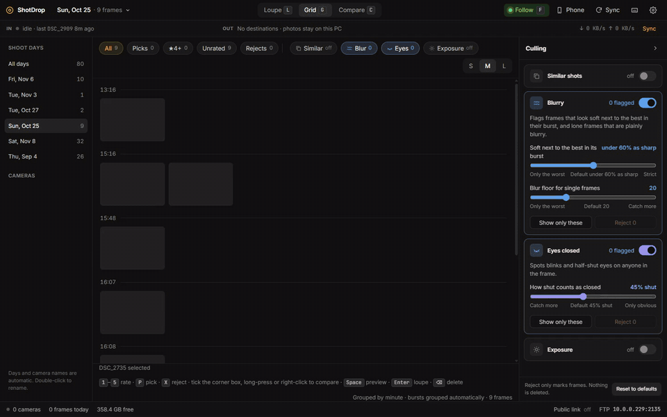
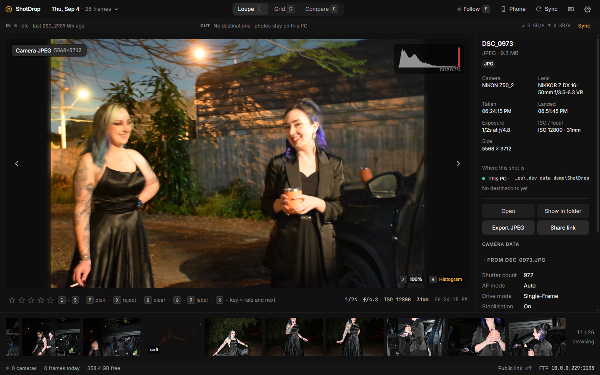
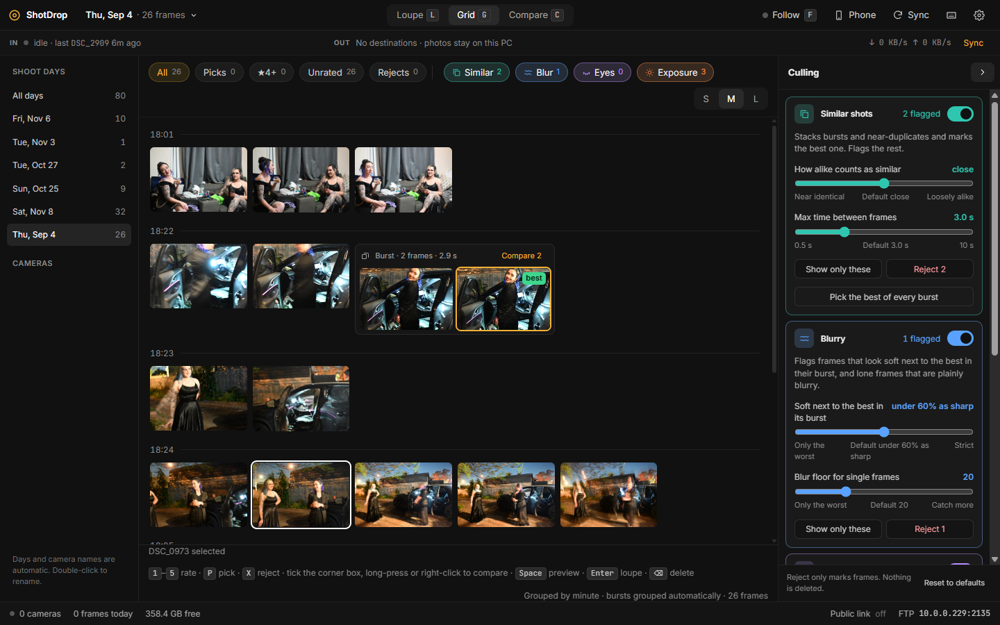
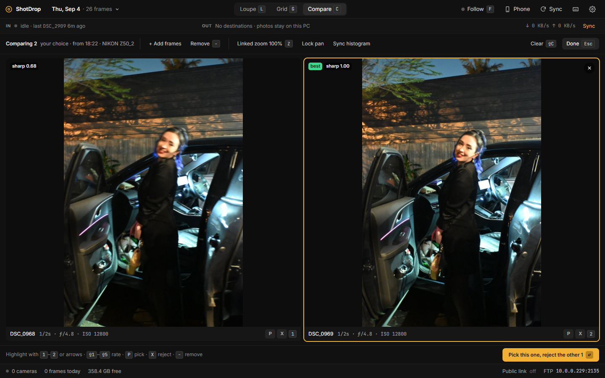
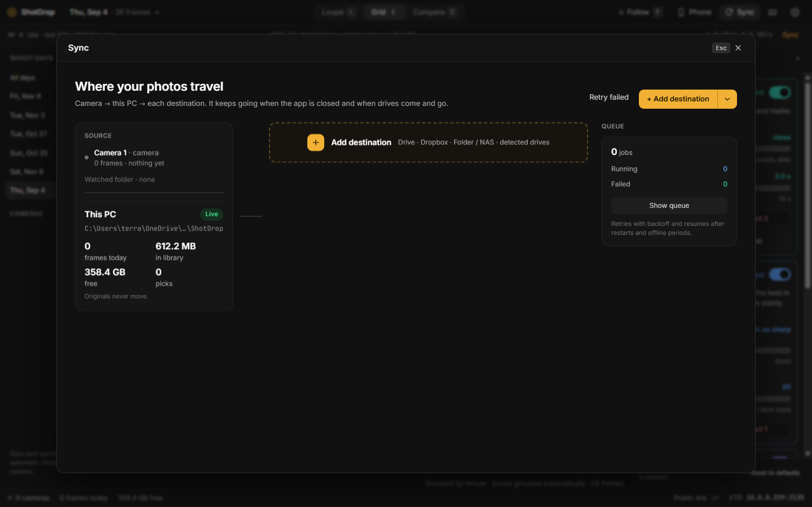
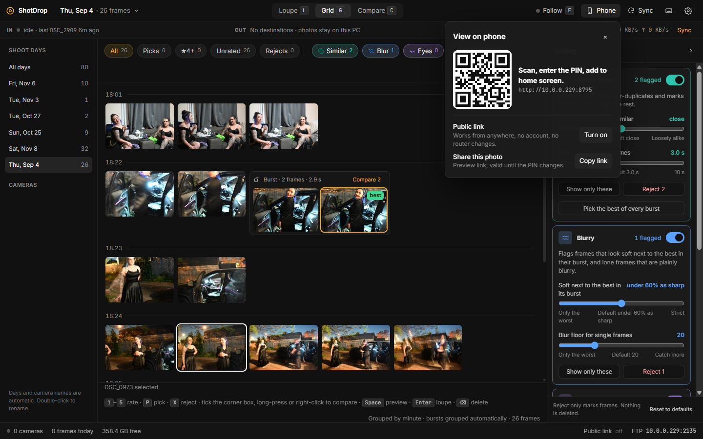
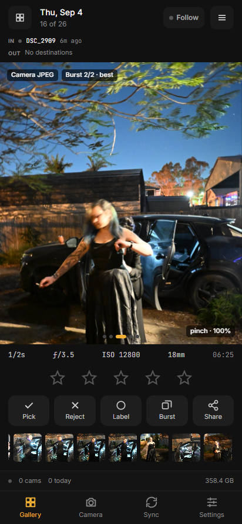
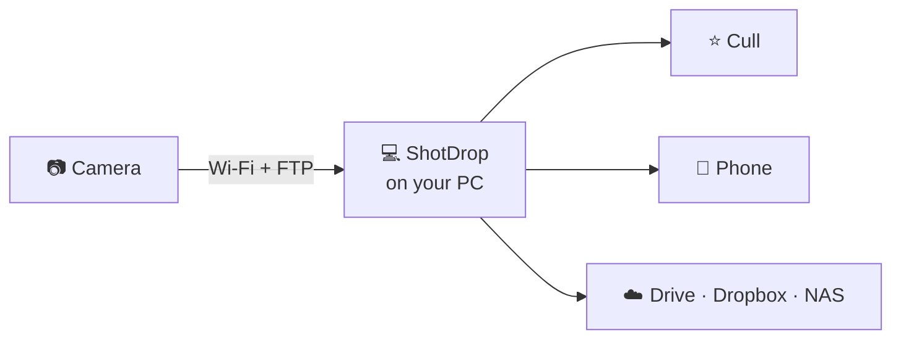

<div align="center">

# ShotDrop

**Shoot on the camera. See it on your screen seconds later.**<br>
Cull while you shoot, hand the gallery to your phone, and sync to your own storage.

[](https://github.com/terraseraph/ShotDrop/actions/workflows/build.yml)
[](https://github.com/terraseraph/ShotDrop/releases/latest)


[](https://github.com/terraseraph/ShotDrop/releases/latest/download/ShotDrop-win-x64.zip)
[](https://github.com/terraseraph/ShotDrop/releases/latest/download/ShotDrop-portable.exe)

<sub>[All releases](https://github.com/terraseraph/ShotDrop/releases) · no installer · everything bundled</sub>

</div>

<br>

ShotDrop turns your PC into a wireless landing zone for your camera. Most modern mirrorless bodies can send each shot over Wi-Fi by FTP. ShotDrop runs that FTP server for you, shows every frame in a full-screen gallery as it lands, and copies your photos to Google Drive, Dropbox, a NAS or another drive in the background. It runs entirely on your machine with your own storage: no account, no hosted service, nothing to pay for.



<p align="center"><sub>▶ <a href="docs/media/walkthrough.mp4">Full-quality video</a></sub></p>

<table>
<tr>
<td width="33%" valign="top">

**📡 Wireless ingest**<br>
Built-in FTP server. Point the camera at it and every frame lands in seconds. RAW, JPEG, HEIF and video.

</td>
<td width="33%" valign="top">

**⚡ Cull as you shoot**<br>
Stars, picks and rejects from the keyboard. Bursts stacked, and blur, eyes-closed and exposure flagged for you.

</td>
<td width="33%" valign="top">

**☁️ Your own storage**<br>
Background sync to Google Drive, Dropbox, a NAS or any rclone remote. Survives offline and restarts.

</td>
</tr>
<tr>
<td valign="top">

**📱 Phone view**<br>
Scan a QR code, enter a PIN, and browse and cull on your phone. Optional public link, no router setup.

</td>
<td valign="top">

**🔧 Connection check**<br>
Finds why the camera can't connect (firewall, port, VPN, password) and fixes most of it in one click.

</td>
<td valign="top">

**🔒 Local-first**<br>
No account, no telemetry. One portable folder. Ratings go to XMP sidecars for Lightroom and Capture One.

</td>
</tr>
</table>

## Screenshots

| | |
| --- | --- |
|  |  |
| **Loupe** with camera data, histogram and filmstrip | **Grid** grouped by minute, bursts stacked with the best marked, culling panel |
|  |  |
| **Compare** a burst side by side and keep the sharpest | **Sync** route board: camera → this PC → destinations |
|  |  |
| **View on phone:** QR code + PIN, optional public link | **Phone layout** |

<p align="center">
<a href="#how-it-works">How it works</a> ·
<a href="#features">Features</a> ·
<a href="#quick-start">Quick start</a> ·
<a href="#camera-setup">Camera setup</a> ·
<a href="#settings">Settings</a> ·
<a href="#troubleshooting">Troubleshooting</a> ·
<a href="#development">Development</a> ·
<a href="#packaging-and-releases">Releases</a> ·
<a href="#roadmap">Roadmap</a>
</p>

## How it works



1. The camera uploads each shot over its built-in FTP client to the FTP server inside ShotDrop.
2. ShotDrop checks the file is complete, files it by date, reads the metadata and builds previews. The photo appears in the gallery straight away.
3. You cull as you shoot: rate, pick, reject, compare bursts. Flags for similar, soft, eyes-closed and bad-exposure frames help.
4. You can view and cull from your phone over the local network or a public link, and ShotDrop copies photos to your own storage in the background.

## Features

### 📡 Ingest (camera to screen)
- **Built-in FTP server** for camera uploads. Toggle it on, no FileZilla or port setup.
- **Full-screen camera setup:** big connection card, ftp:// QR code, guides per camera brand, and a live "listening" log that shows the test shot arriving.
- **Pick the right network address.** Every address on the PC is listed with its adapter and type (Wi-Fi, Ethernet, VPN). Choose the one the camera should use; VPNs such as Tailscale and WireGuard sort last.
- **Several cameras at once,** each with its own login, so every frame is tagged by camera or shooter, with per-camera filters.
- **JPEG, HEIF and RAW** (ARW, CR3, NEF, RAF, DNG and more). RAW+JPEG pairs are grouped as one shot.
- **Video files** (MP4, MOV, MXF, MTS): thumbnails, plus a browser-playable copy for codecs that won't play directly (HEVC, ProRes, 10-bit).
- **Watched folders** for card readers or tethering software. Originals are copied, never moved.
- **Safe ingest:** half-written uploads are never shown or synced, duplicates are detected by hash, and every upload is written to `ftp.log` for troubleshooting.
- **Wi-Fi live view over PTP/IP** (experimental, Nikon Z): live view and shot download without FTP.

### 🔧 Connection check
- **One-click fixes** for the usual reasons a camera can't connect:
  - Windows Firewall rules for your local network only, including removing the hidden block rule Windows creates when someone clicks Cancel on its prompt.
  - Port clashes: names the program holding the port and moves to a free one.
  - Wrong network adapter or VPN warnings.
  - A self-test that logs in the way a camera does.
  - Refused camera logins ("wrong password from 192.168.x.x").
  - Disk space.

### 🖼️ Viewing
- **Follow mode:** the big view jumps to each new frame as it lands, like wireless tethering.
- **Loupe, grid and filmstrip,** with **100% zoom and pan** for focus checks.
- **Grid grouped by minute,** with bursts stacked and the best frame marked.
- **Histogram and highlight-clipping** overlay (`H`).
- **Compare up to 4 shots** side by side (`C`, `Shift+C` clears).
- **EXIF at a glance:** shutter, aperture, ISO, focal length, lens, camera, time.
- **Sessions and filters:** shoot days grouped as sessions, plus filters by camera, pick, rating and reject.
- **Status dock** showing cameras connected, frames received, sync progress and disk space.

### ⭐ Culling
- **Keyboard-first:** `1`–`5` stars, `P` pick, `X` reject, `U` clear, `6`–`9` colour labels. Add `Shift` to rate and move to the next shot.
- **Automatic burst grouping:** bursts and near-duplicates are stacked and the best frame is marked. **Compare** puts a burst side by side; one key keeps the best and rejects the rest.
- **Flags:** **similar**, **soft/blurred**, **eyes closed** and **bad exposure** (blown highlights or crushed shadows). One-click filter chips: *All*, *Picks*, *★4+*, *Unrated*, *Rejects*, *Similar*, *Blur*, *Eyes*, *Exposure*. The culling panel adjusts each detector's threshold. Flags only mark frames; nothing is deleted.
- **XMP sidecars:** ratings, picks/rejects and labels are written to `<name>.xmp` next to each photo, so Lightroom and Capture One see your culling. Sidecars sync with the photos and are read back on import.
- **Delete really deletes:** the recycle bin first, then a permanent delete if needed. If a file is locked by another program, you get a warning naming it, and the photo stays in the gallery so nothing is left orphaned on disk.

### 🎞️ RAW and metadata
- **Previews from the largest JPEG embedded in the RAW,** with its true size shown.
- **Develop RAW:** a full-resolution decode with LibRaw (bundled, no extra runtime needed). Switch between camera JPEG, embedded preview and RAW decode.
- **All metadata:** EXIF, maker notes, XMP, IPTC and GPS, searchable. The summary shows shutter count, AF point, drive mode, stabilisation, serial numbers, firmware, white balance and film simulation or picture profile when the camera records them. GPS gets an "Open in maps" link.

### 📱 Phone and sharing
- **Remote gallery in any browser,** protected by a PIN. Remote viewers can look and cull, but settings stay on the PC.
- **Phone app (PWA):** scan the **View on phone** QR code, enter the PIN, and add it to your home screen. Touch layout with swipe, pinch zoom and a culling bar.
- **Public link from anywhere** with one click, via a Cloudflare quick tunnel. No account and no router changes.
- **Share link** to a single photo's preview through the remote gallery or public link. It stays valid until you change the PIN.

### 📤 Export
- **Export JPEG** at original size, 2048 or 1080 px, with your choice of quality and with metadata kept, GPS stripped, or everything stripped.
- **Copy to clipboard, Show in folder, Open, Open in** Lightroom, Photoshop, Capture One, Affinity or DxO when installed.
- **Drag a thumbnail** straight into Explorer, email or an editor.

### ☁️ Sync and backup
- **Route board** (Settings → Sync) shows where photos travel: camera → this PC → each destination, with live progress and health on every card: Up to date, Syncing, Paused, Can't reach, Failed or Sign-in expired.
- **One-click Google Drive and Dropbox.** Sign in in your browser, then pick or create the folder. By default Drive access is limited to folders ShotDrop creates. Accounts are kept in ShotDrop's own config, and your own app credentials are supported.
- **Folder / NAS** destinations (local drives or network shares), plus **any rclone remote** (S3, B2, SFTP, OneDrive…) for advanced setups.
- **Choose what each destination gets:** everything, JPEGs only, RAW only, or **picks only**, which are sent the moment you press `P`. The sheet shows how many files and how much data that is right now.
- **A background queue that survives anything:** offline periods, unplugged drives and restarts. It retries, then catches up. Pause and resume per destination, errors in plain English, and **Reconnect** when a sign-in expires.

### 🔒 Local-first and portable
- **Everything in one portable package.** Settings and the database stay next to the app, and photos default to `Pictures\ShotDrop` (or any folder you choose).
- **No hosted service, no telemetry, no account.** Your photos only go where you send them.
- **REST API with live events** for scripting and integrations. The app's own UI uses the same API (see [REST API](#rest-api)).

### 🚧 Not yet
FTPS for cameras, drag-and-drop import, rename/folder rules, batch delete of rejects, rsync/SSH destinations, bandwidth limits, tray icon and notifications, auto-update, macOS/Linux builds, a named Cloudflare tunnel with a fixed URL, uploads from cameras outside your network, and client proofing galleries.

## Quick start

1. **Download** the zip above, unzip it anywhere (even a USB stick) and run `ShotDrop.exe`. It starts in about 3 s. The single-file portable .exe unpacks itself on every launch, so it starts slower (about 12 s); use it when you need one file to hand to someone.
2. **First run:** the setup screen shows the **host, port, user and password** in big type, plus a QR code.
3. **Camera:** put it on the same Wi-Fi as the PC, open its FTP transfer menu, and type those in. ShotDrop has step-by-step guides for Sony, Canon, Nikon and Fujifilm (and a generic one).
4. **Shoot.** The photo appears in the gallery a few seconds later. If nothing arrives, the **Connection check** tells you why and fixes most causes with one click.

Notes on the download:
- **No installer, nothing else to install.** rclone, cloudflared, ffmpeg, LibRaw and ExifTool are all inside the package.
- **Unsigned for now.** Windows SmartScreen may say "Windows protected your PC": click **More info → Run anyway**.
- On first launch, allow ShotDrop through Windows Firewall on private networks, or use **Settings → Camera → Connection check → Allow cameras**.
- Builds from the latest commit are attached to each [Actions run](https://github.com/terraseraph/ShotDrop/actions/workflows/build.yml).

| | Windows 10 / 11 (64-bit) | |
|---|---|---|
| **Recommended** | [**ShotDrop-win-x64.zip**](https://github.com/terraseraph/ShotDrop/releases/latest/download/ShotDrop-win-x64.zip) | Unzip anywhere and run `ShotDrop.exe`. Starts in about 3 s. |
| Single file | [ShotDrop-portable.exe](https://github.com/terraseraph/ShotDrop/releases/latest/download/ShotDrop-portable.exe) | Unpacks itself on every launch, so it starts slower (about 12 s). |

## Camera setup

Every camera needs the same four values from ShotDrop's setup screen: **address, port, user and password**. Use plain **FTP** (not SFTP or FTPS), passive mode on, and leave the target folder blank or at root. The camera and PC must be on the same Wi-Fi. These are the menu paths used by ShotDrop's built-in guides; exact names vary by model and firmware.

<details>
<summary><b>Menu paths for Sony, Canon, Nikon and Fujifilm</b></summary>

**Sony**
1. Network → Transfer/Remote → FTP Transfer Func. → Server Setting. Pick an empty server slot.
2. Destination settings: enter the address, port, user and password. Secure protocol Off, passive mode On.
3. FTP Transfer Func. → On, Auto FTP Transfer → On.

**Canon**
1. Network settings → Connection option settings → FTP transfer. Run the wizard: pick the Wi-Fi network, then FTP (not SFTP).
2. Enter the address, port, user and password. Passive mode Enable, proxy none, target folder Root.
3. Transfer settings → Auto transfer → Enable.

**Nikon**
1. Network menu → Connect to FTP server → Create profile. Join the same Wi-Fi as this PC.
2. Server type FTP, then address, port, user and password. Passive mode On.
3. Options → Auto send → On.

**Fujifilm**
1. Network/USB settings → FTP transfer settings → Server settings. Server and port from the card, passive mode On.
2. User ID and password from the card. Leave the upload folder blank.
3. Join the same Wi-Fi, then Auto Image Transfer Order → On.

</details>

**Other brands:** find FTP, FTP transfer or Network upload in the camera menu, enter the four values, join the same Wi-Fi and turn on automatic transfer.

Take a shot. It shows up in ShotDrop in a few seconds.

### Camera compatibility (built-in FTP)

Firmware updates keep adding FTP to more bodies, so check your model. This is a starting list, not a guarantee.

| Brand | Models | Notes |
|---|---|---|
| Sony | a1, a1 II, a9 II, a9 III, a7 IV, a7 V, a7R V, a7S III, a7C II, a7CR, a6700, FX3, FX30 | |
| Canon | R1, R3, R5, R5 II, R6 II, R6 III, 1D X III | Older bodies need a WFT transmitter |
| Nikon | Z9, Z8, Z6III | Older Z bodies need a WT-7. PTP/IP live view is experimental |
| Fujifilm | X-H2S, X-H2, GFX100 II | Some need the FT-XH grip or updated firmware |
| Panasonic | S5II/S5IIX, GH7, S1R II | Mainly Frame.io Camera-to-Cloud; FTP support varies |

Entry-level bodies usually only support the maker's phone app, which ShotDrop can't receive from.

## Settings

- **Camera:** FTP on/off, network address, port, logins (one per camera or shooter), **Connection check**, watched folders, and the library folder (default `Pictures\ShotDrop`).
- **Sync:** destinations (Google Drive, Dropbox, folder/NAS, any rclone remote), what each one receives, pause/resume and reconnect.
- **Phone and remote:** remote access, the PIN, the **View on phone** QR code and the optional public link.
- **Culling:** burst grouping and the thresholds for similar, soft, eyes-closed and exposure flags.
- Changes to FTP, library, watch folders and remote access apply live, with no restart.

## Troubleshooting

Open **Settings → Camera → Connection check** first. It tests the whole path and offers a one-click fix for each problem it finds:

- **Camera can't connect:** allow ShotDrop through Windows Firewall on private networks (**Allow cameras**). The check also removes the hidden block rule Windows creates if someone clicked Cancel on its prompt.
- **Port in use:** the check names the program holding the port and moves ShotDrop to a free one. Update the port on the camera afterwards.
- **Wrong address:** if the camera is told a VPN or other adapter's address, choose the Wi-Fi or Ethernet address in the setup screen.
- **Camera connects but logs in wrong:** the check lists refused logins with the camera's IP, so you can spot a typo in the password.
- **Photos not showing:** check free disk space in the check, and look in `ftp.log` for each upload attempt.
- **Windows SmartScreen warning:** the app is unsigned. Click **More info → Run anyway**.
- **A photo won't delete:** another program has the file locked. The warning names it; close it and delete again.

## Development

```bash
npm install
npm run dev              # Electron app + Vite renderer with hot reload
npm run typecheck
npm run fetch-binaries   # pinned rclone, cloudflared, ffmpeg, LibRaw into resources/bin (needed for sync/RAW in dev)
npm run dist:portable    # release/ShotDrop-win-x64.zip + release/ShotDrop-portable.exe
```

- **Dev data:** all settings, the database, previews and the library go into a gitignored `.dev-data/` folder, so test shots never touch your real Pictures folder.
- **A second dev copy** next to the first needs its own data folder and ports. Create `<dir>/app/settings.json` containing `{"api":{"port":8792},"ftp":{"port":2132,"pasvMin":51200,"pasvMax":51220}}`, then run:
  ```bash
  SHOTDROP_DEV_HOME=<dir> SHOTDROP_VITE_PORT=5182 VITE_SHOTDROP_API=http://127.0.0.1:8792 npm run dev
  ```
- **Desktop-only screens in a browser:** add `?desktop` to the dev URL (dev builds only) to see Settings and setup screens in a browser tab.
- **Fake a camera:** `curl -T DSC01234.JPG ftp://camera:<password>@127.0.0.1:2121/`

### Stack

| Layer | Choice |
|---|---|
| Shell | Electron |
| UI | React, TypeScript, Vite, Motion |
| Server | Fastify (REST + SSE), ftp-srv |
| Images | sharp, ExifTool (exiftool-vendored), LibRaw (`dcraw_emu`) |
| Video | ffmpeg |
| Data | SQLite (better-sqlite3) |
| Sync and remote | rclone, cloudflared |
| Culling | MediaPipe face landmarks (eyes closed), luma sharpness, perceptual hash |

<details>
<summary><b>Project layout</b></summary>

```
src/
  shared/              types shared by server and UI (types.ts, cull.ts, diagnostics.ts)
  main/
    index.ts           Electron shell: window, IPC (folder picker, open-with, clipboard, drag-out), lifecycle
    core/              no Electron imports: could run headless (NAS, home server)
      index.ts         Core: wires everything together, applies settings changes live
      ftp.ts           embedded FTP server, one folder per camera login, upload log
      ingest.ts        watcher → hash/dedupe → EXIF → file by date → previews
      media.ts         previews (sharp), embedded RAW JPEGs, LibRaw develop, video frames/proxies (ffmpeg)
      library.ts       SQLite: shots, files, sync jobs
      sync.ts retry.ts background sync queue (folder copy, rclone) with offline-aware retries
      cloud.ts         Google Drive / Dropbox accounts via rclone with ShotDrop's own config
      xmp.ts metadata.ts exporter.ts sources.ts   sidecars, full metadata, export, RAW sources
      diagnostics.ts firewall.ts net.ts           connection check, firewall fixes, address picking
      tunnel.ts        Cloudflare quick tunnel
    api/               Fastify REST API + SSE, serves the web/phone UI
    ptp/               PTP/IP client (Wi-Fi live view, experimental)
    blink/             eyes-closed detection for burst culling
  preload/index.ts     exposes the API base + native helpers to the window
  renderer/            React UI, also served to phones and remote browsers
docs/                  packaging.md, raw.md, cloud-linking.md, mockups/
```

</details>

### REST API

<details>
<summary><b>Endpoints</b> (the desktop window uses the same API)</summary>

The desktop window uses the same HTTP API a phone or script would. It listens on `127.0.0.1:8787`, or on all interfaces when remote access is on. Requests that don't come from this PC, including anything through the tunnel, need the PIN as an `x-shotdrop-key` header or a `?key=` parameter. Endpoints marked **local** refuse remote callers even with the PIN, because they change configuration, run programs or send photos elsewhere.

| Method | Path | |
|---|---|---|
| GET | `/api/status` | FTP, cameras, API, library, sync, tunnel and per-destination state |
| GET | `/api/events` · `/api/changes?after=<seq>` | Live events (SSE), or the polling equivalent used through tunnels |
| GET | `/api/sessions` · `/api/library/counts` | Shoot days; file counts and sizes per sync filter |
| GET | `/api/shots` | `?session=&source=&minRating=&flag=-1\|0\|1\|notRejected&label=&order=&limit=&offset=` |
| GET / PATCH | `/api/shots/:id` | One shot; `{ rating?, flag?, label? }`. `PATCH /api/shots` does bulk updates |
| DELETE | `/api/shots/:id` | Deletes from disk; `409` with the files that couldn't be removed |
| GET | `/api/shots/:id/thumb` · `/preview` · `/original?file=` · `/full?src=` · `/sources` · `/metadata` | Images, RAW sources, full metadata |
| POST | `/api/shots/:id/develop` · `/export` · `/proxy` (local) | RAW decode, JPEG export, video proxy |
| GET | `/api/shots/:id/link` (local) | Share link to one preview |
| GET / PATCH | `/api/settings` (local) | Changes apply live (FTP, library, watch folders, remote) |
| GET / POST / PATCH / DELETE | `/api/destinations[/:id]` (local) | `{ name, type: folder\|rclone, target, filter: all\|jpeg\|raw\|picks, enabled }`; `POST …/resync` |
| GET / POST | `/api/sync/jobs` · `/api/sync/retry` (local) | Queue inspection, retry failed |
| * | `/api/cloud/…` (local) | Link/cancel/disconnect accounts, browse/create folders, account info |
| * | `/api/tunnel[/install\|start\|stop]` | Public link state and control (control is local) |
| * | `/api/diagnostics[/attempts\|/fix/:id]` (local) | Connection check and one-click fixes |
| POST | `/api/ftp/start` · `/api/ftp/stop` (local) | |

</details>

## Packaging and releases

`npm run dist:portable` fetches the pinned helper binaries, builds with electron-vite and writes `release/ShotDrop-win-x64.zip` and `release/ShotDrop-portable.exe`. Both hold the same app with every dependency inside.

**Releases:** every push to `main` builds both packages on Windows with [GitHub Actions](.github/workflows/build.yml) and publishes them as a new release numbered `0.1.<build>`, so the download links above always serve the newest build. Push a tag such as `v0.2.0` for a named version. Pull requests build too, with the files attached to the Actions run.

More detail:
- [docs/packaging.md](docs/packaging.md): portable build, bundled tools, licences
- [docs/raw.md](docs/raw.md): RAW decoding
- [docs/cloud-linking.md](docs/cloud-linking.md): Drive/Dropbox via rclone
- [docs/mockups/cloud](docs/mockups/cloud/index.html): Sync UI design

## Roadmap

- **Next:** FTPS for cameras, rename/folder rules, batch actions on rejects, tray icon and notifications, auto-update.
- **Remote ingest:** a phone-hotspot field kit today; port-forwarded FTPS or a relay later.
- **Android:** the phone as the server (camera → phone hotspot → ShotDrop on Android), reusing the same React UI.
- **Client proofing:** guest galleries with picks and comments, built on photos already in the photographer's own cloud.
- macOS and Linux builds.

## Third-party software

The Windows package bundles unmodified builds of **rclone** (MIT), **cloudflared** (Apache-2.0), **ffmpeg** (GPL-3.0; gyan.dev essentials build), **LibRaw** (LGPL-2.1 / CDDL-1.0, from MSYS2 with its runtime DLLs) and **ExifTool** (Perl Artistic / GPL). Their licence texts ship with them (`resources\bin\LICENSE-*.txt`, and ExifTool's inside its package). See [docs/packaging.md](docs/packaging.md).
